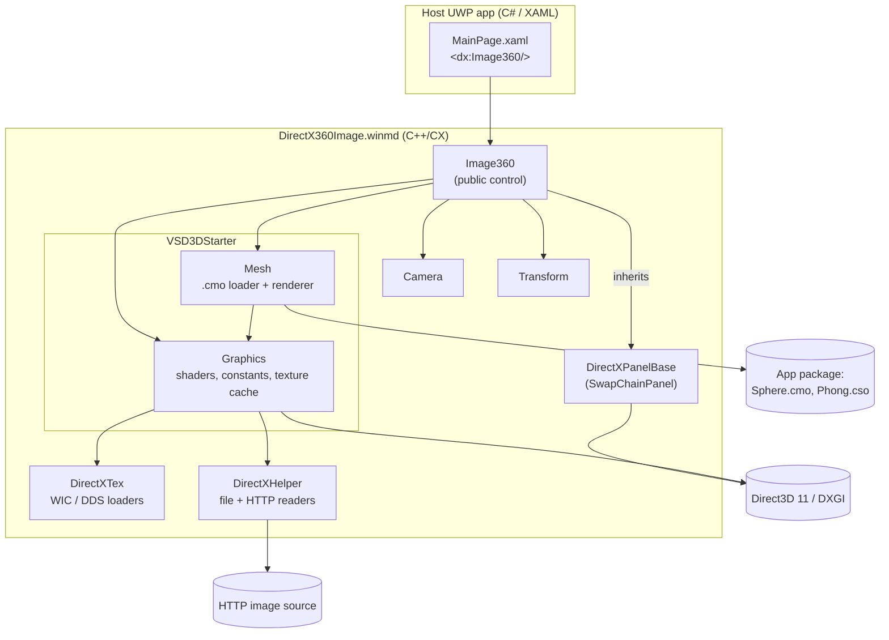
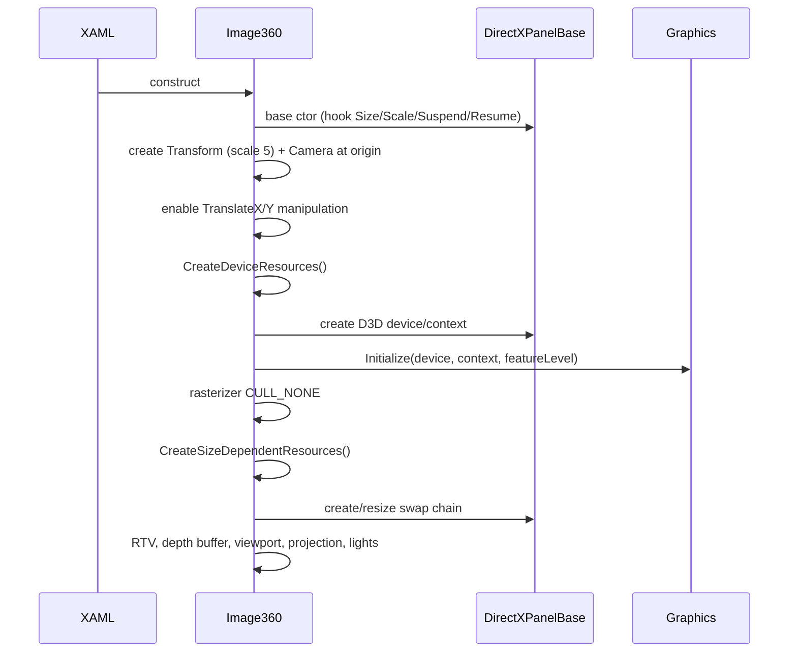
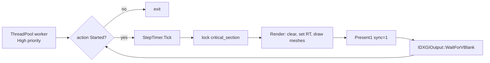

# UWP360 — Solution Architecture

This document explains how the `DirectX360Image` component is structured, how data moves through it at runtime, and which design decisions shape it.

---

## 1. Overview

UWP360 shows a **360° equirectangular image** by mapping it onto the **inside of a sphere** and placing a **perspective camera at the sphere's center**. User drag gestures rotate the camera. The control is a C++/CX **Windows Runtime component**, so any UWP language can use it from XAML.



---

## 2. Projects

| Project | Type | Language | Responsibility |
|---|---|---|---|
| `DirectX360Image` | Windows Runtime Component (`.dll` + `.winmd`) | C++/CX | Rendering engine and public `Image360` XAML control |
| `360ImageTest` | UWP application | C# | Sample host app that shows XAML usage and runtime image swapping |

---

## 3. Components

### 3.1 `Image360` (public control)
`Image360.h`, `Image360.cpp`

This is the only type a consumer must know about. Its responsibilities are:

- **Public API**: the `TextureSource` dependency property, the `Camera` and `Transform` accessors, the `ModelLoaded` event, and `Clear()`.
- **Asset orchestration**: on the first `TextureSource` assignment, it loads `Sphere.cmo` and the texture. On later assignments, it swaps only the texture.
- **Input**: it maps `ManipulationDelta` translation (in pixels) to camera yaw (`RotateY`) and pitch (`Pitch`) in degrees.
- **Render loop**: it runs a high-priority thread-pool worker that ticks `StepTimer`, renders under a lock, and then calls `WaitForVBlank()`.
- **Pipeline setup**: it creates the render target view, the depth/stencil buffer and viewport, a rasterizer state with `CULL_NONE`, a projection with a 70° vertical FOV, and the scene lighting.

### 3.2 `DirectXPanelBase` (infrastructure)
`Common/DirectXPanelBase.h/.cpp`

This is a reusable base class derived from `SwapChainPanel`. It owns:

- The `ID3D11Device1` and `ID3D11DeviceContext1`, with a WARP fallback.
- The composition swap chain `IDXGISwapChain2`, which uses flip-sequential mode, 2 buffers, and a maximum frame latency of 1.
- Handlers for **SizeChanged** and **CompositionScaleChanged**, which resize buffers and apply an inverse scale transform so the image stays sharp.
- Handlers for **Suspending**, which calls `IDXGIDevice3::Trim`, and for **Device lost**, which recreates all resources.
- `Present()` and a `critical_section` that serializes the UI thread with the render thread.

Subclasses override `CreateDeviceResources`, `CreateSizeDependentResources` and `Render`.

### 3.3 `Camera`
`Camera.h/.cpp`

This is a left-handed, first-person camera. It stores an orthonormal basis (`Right`, `Up`, `Look`) and a position.

- `SetLens` builds the perspective projection, which can be multiplied by an orientation matrix.
- `Pitch` rotates around the camera's right vector. `RotateY` rotates around the world Y axis.
- `UpdateViewMatrix` re-orthonormalizes the basis and rebuilds the view matrix.

### 3.4 `Transform`
`Transform.h/.cpp`

This holds the sphere's `Scale`, `Rotation` (in degrees) and `Translation`, and produces the world matrix used by `Mesh::Render`. `Image360` scales the sphere ×5.

### 3.5 `VSD3DStarter` (graphics layer)
`VSD3DStarter.h`

This is adapted from the Visual Studio Direct3D starter kit.

- **`Graphics`**: manages the vertex shader, input layout, sampler, constant buffers (material, light, object, misc) and the **texture/pixel-shader caches**, which are keyed by name.
  - *Customization*: `GetOrCreateTextureAsync` checks the texture name. Names that start with `http` are downloaded through `HttpClient`. Other names are read from the package. Both are decoded with **WIC**, so JPEG and PNG work.
- **`Mesh`**: parses the binary `.cmo` format (materials, submeshes, vertex and index buffers, and optional bones) and draws it.
  - *Customization*: `LoadFromFileAsync` reads from the `DirectX360Image` package folder and **replaces every material texture with `TextureUrl`**.

### 3.6 Supporting code

| Folder/File | Purpose |
|---|---|
| `DirectXTex/` | `WICTextureLoader` and `DDSTextureLoader` (DirectXTK) |
| `Common/DirectXHelper.h` | `ThrowIfFailed`, `ReadDataFromPackageAsync`, `ReadDataFromHttpAsync` |
| `Common/StepTimer.h` | Frame timing |
| `ppltasks_extra.h` | `create_value_task` and `create_iterative_task` PPL helpers |
| `Animation/` | `SkinnedMeshRenderer` for animated meshes (off by default) |

---

## 4. Runtime flows

### 4.1 Control initialization



### 4.2 Setting `TextureSource`

```mermaid
sequenceDiagram
    participant XAML
    participant I as Image360
    participant M as Mesh
    participant G as Graphics
    participant Net as HttpClient

    XAML->>I: TextureSource = uri
    I->>I: OnTextureSourceChanged → SetTextureSource
    alt first image (no meshes yet)
        I->>M: LoadFromFileAsync("Sphere.cmo", uri)
        M->>G: GetOrCreatePixelShaderAsync(Phong.cso)
        M->>G: GetOrCreateTextureAsync(uri)
        G->>Net: GET uri
        Net-->>G: bytes
        G-->>M: SRV (WIC decoded, cached)
        M-->>I: meshes ready
        I->>I: m_loadingComplete = true; raise ModelLoaded
    else subsequent image
        I->>G: GetOrCreateTextureAsync(uri)
        G-->>I: SRV
        I->>I: reset camera; replace material texture
    end
    I->>I: StartRenderLoop() (no-op if running)
```

### 4.3 Render loop



`Render()` returns early until loading is complete. The loop stops on `Unloaded` and in the destructor.

### 4.4 Interaction

`ManipulationDelta` → `Camera.RotateY(-dx°)` and `Camera.Pitch(-dy°)` → `UpdateViewMatrix()`. The next frame then uses the new view.

---

## 5. Threading model

| Thread | Work |
|---|---|
| UI thread | XAML events, property changes, manipulation, resize, and `SetSwapChain` through the Dispatcher |
| Render worker | `Render()` and `Present()` once per VBlank |
| PPL / thread pool | Async file I/O, HTTP download, and shader/texture creation |

`DirectXPanelBase::m_criticalSection` guards device and size-dependent state between the UI thread and the render thread.

---

## 6. Rendering pipeline

| Stage | Configuration |
|---|---|
| Geometry | `Sphere.cmo` (unit sphere, UV-mapped), world = scale ×5 |
| Vertex shader | Starter-kit default (from `Graphics`) |
| Pixel shader | `Phong.cso` (DGSL Phong) |
| Rasterizer | `CULL_NONE`, MSAA and AA lines enabled |
| Depth | `D24_UNORM_S8_UINT` |
| Projection | Perspective LH, FOV Y = 70°, near 1, far 1000 |
| Lighting | Ambient 0.3 and one light from +Y |
| Swap chain | `B8G8R8A8_UNORM`, flip-sequential, 2 buffers, premultiplied alpha |

---

## 7. Assets and deployment

The following files are marked `DeploymentContent` and are copied into the app package under `DirectX360Image\`:

- `Sphere.cmo`: the sphere mesh, compiled from a 3D model by the VS mesh content pipeline.
- `Phong.cso` and `_..._Phong.dgsl.cso`: the compiled pixel shaders referenced by the mesh material.

Host apps need the **`internetClient`** capability to load remote images.

---

## 8. Design decisions

| Decision | Rationale |
|---|---|
| Sphere with the camera inside | Simplest way to display equirectangular projections. UVs map directly. |
| `SwapChainPanel` instead of `SwapChainBackgroundPanel` or `CoreWindow` | Works with other XAML content and layouts. |
| WinRT component (C++/CX) | Any UWP language can use it. Direct3D is native. |
| Rendering paced by VBlank on a background thread | Keeps the UI responsive and avoids rendering faster than the display. |
| Texture cache keyed by URI | Switching back to an image already viewed costs nothing. |
| WIC decoding | Supports common image formats (JPEG and PNG) without extra code. |

---

## 9. Known limitations and suggested clean-ups

These items were found during review. The code was **not** changed to fix them.

- `LoadAsync` ignores its `meshFilename` argument and always loads `Sphere.cmo`. The `ModelName` property therefore has no effect.
- `Mesh::ReadAsync` overwrites every texture slot with `TextureUrl`.
- `m_Accelerometer` is declared but never used.
- `Common/Camera.*` and `Common/Model.*` are not in the `.vcxproj` and are unused duplicates. They can be removed.
- `Image360.cpp` contains `#pragma once`, includes `<math.h>` twice, and declares an unused `Transparent` local variable.
- `m_skinnedMeshRenderer` is not initialized to `nullptr`, so the destructor's null check depends on an indeterminate value.
- HTTP download errors for subsequent images are not surfaced to the caller.
